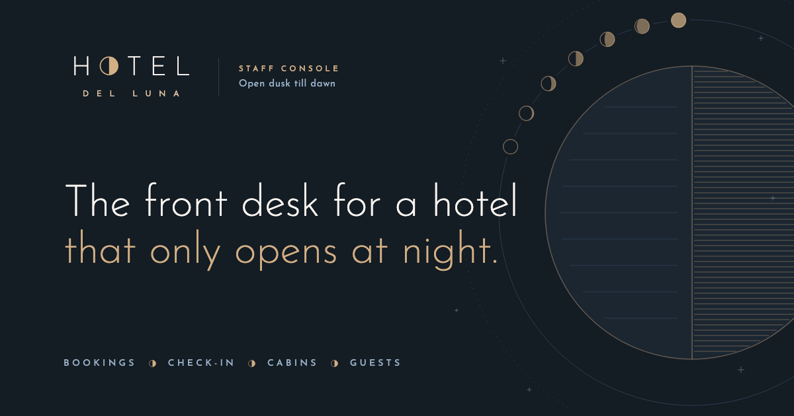
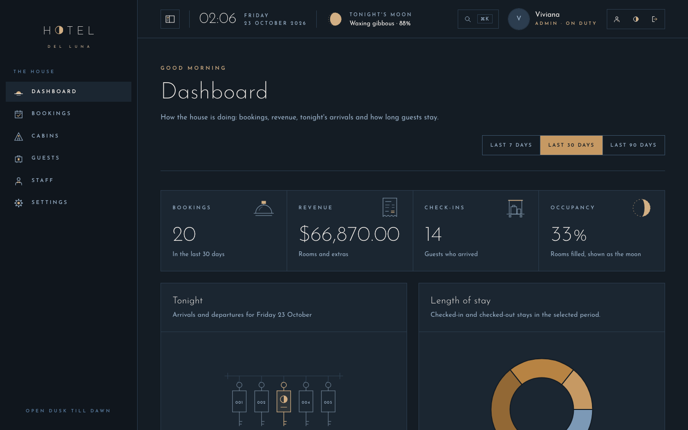
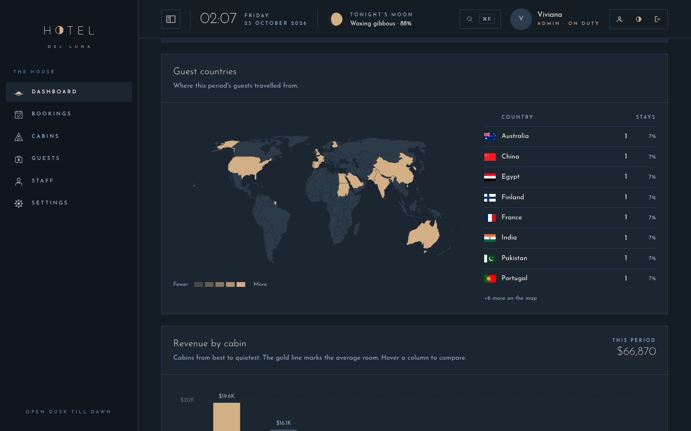
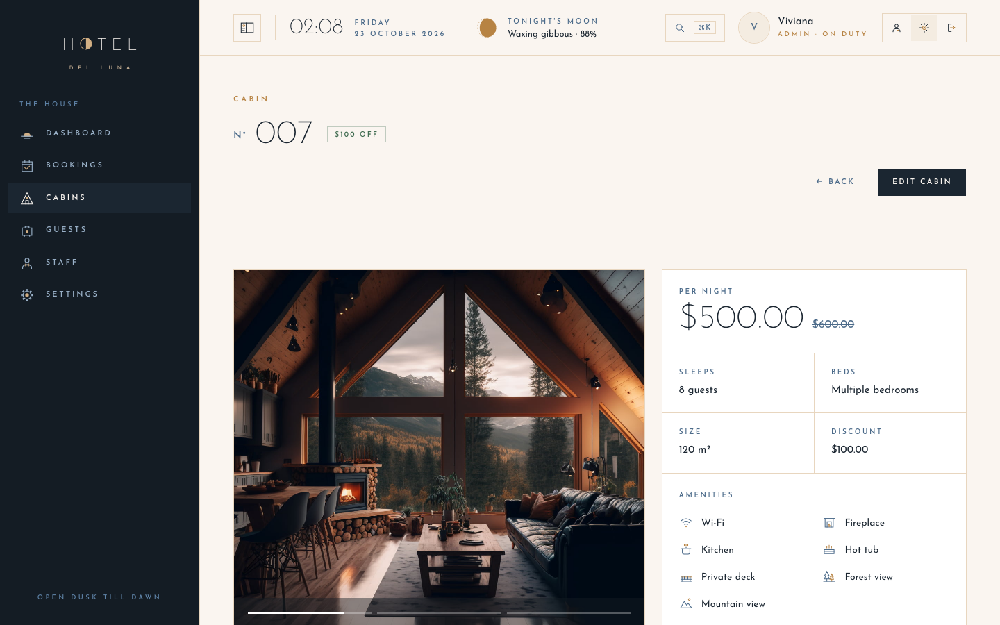
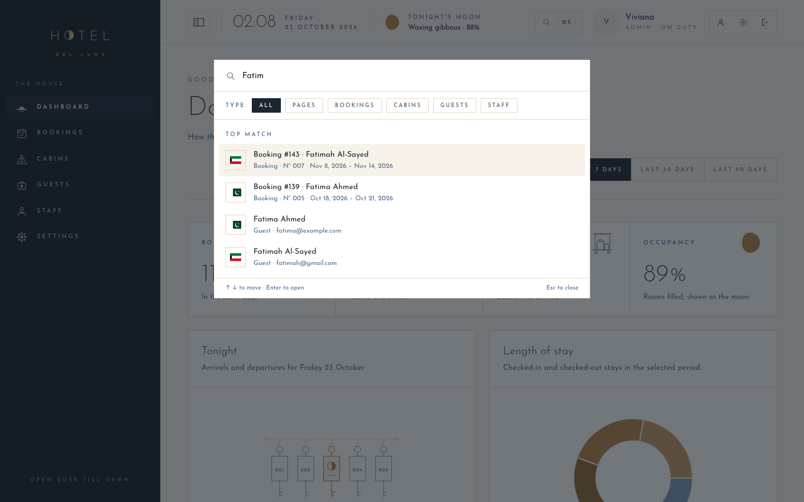
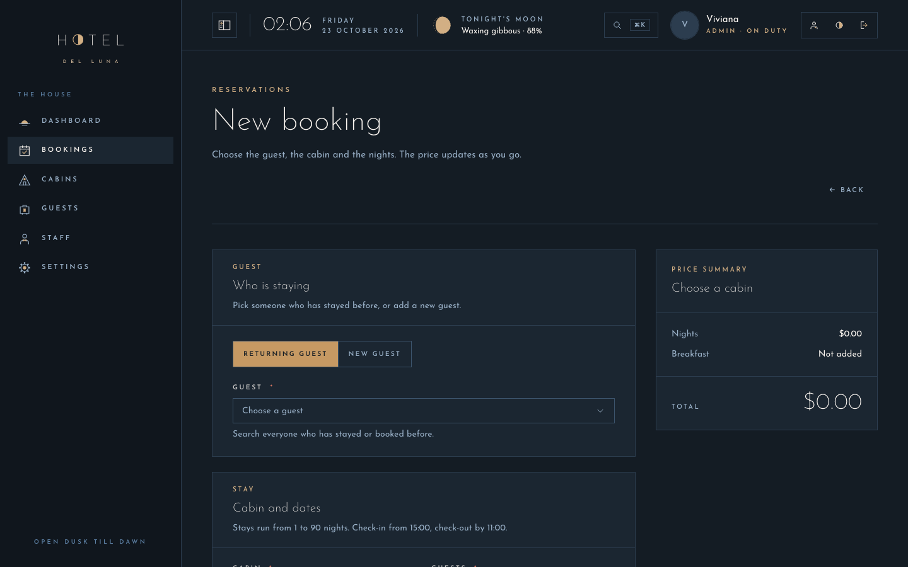
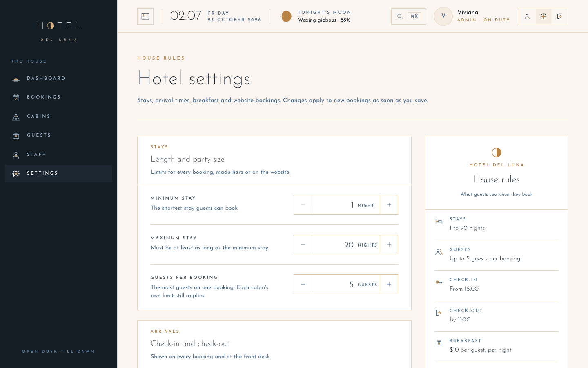

# Hotel del Luna

**Staff console · open dusk till dawn** — a hotel management app for the front desk of a hotel that only opens at night, with bookings, cabins, check-in, guests, staff roles and a day and night theme lit by the moon.

**Live demo:** [hoteldelluna-console.vivianaein.dev](https://hoteldelluna-console.vivianaein.dev). Sign in with a demo card on the login page: **Viviana** (owner, admin) or **Bubu** (front desk, staff). The demo data resets every night.



## Table of contents

- [How I built it](#how-i-built-it)
- [Screenshots](#screenshots)
- [Features](#features)
- [Design](#design)
- [Tech stack](#tech-stack)
- [Project structure](#project-structure)
- [Getting started](#getting-started)
- [Deployment](#deployment)
- [License](#license)

## How I built it

I started from a small hotel admin console (cabins, bookings, check-in and check-out, and a few settings) with React Query for server state and Supabase for the database, sign-in and photo storage.

Then I gave it an identity. I named it after *Hotel del Luna*, the Korean drama about a hotel that only opens its doors after dark, drew a logo where the O in HOTEL is a half moon, and built a day and a night theme from ivory, midnight steel and moonlight brass. The moon runs through the whole app: tonight's real moon phase in the header, occupancy drawn as a moon, and a moon phase on every notification.

After that I turned it into something a real front desk could run on:

1. **Roles and a safe demo:** admins and staff see different things, and the database enforces it, not just hidden buttons. Two demo accounts let anyone try it, and the data resets every night.
2. **Bookings from start to finish:** full pages to create and edit bookings, with a guest picker, a calendar that greys out taken nights and a live price. A room chart shows two weeks of stays for every cabin.
3. **Cabins worth opening:** several photos per cabin, amenities, bed type and size, a photo showcase and a calendar of upcoming stays.
4. **Insights:** a dashboard with a world map of where guests come from, revenue by cabin, length of stay and revenue over time.
5. **Finding anything:** a ⌘K search across pages, bookings, cabins, guests and staff, and searches and filters saved in the URL.
6. **Polish:** a drawing for every empty and error state, designed 404 and error pages, page titles, notifications for every action, and a layout that works from phones to wide screens.

The console also shares its database with the hotel's public website, [hoteldelluna.vivianaein.dev](https://hoteldelluna.vivianaein.dev), where guests sign in with Google and book a cabin. Those bookings arrive here tagged as website bookings, checked against the same house rules.

## Screenshots

| Dashboard (night) | Guest countries and revenue by cabin (night) |
| --- | --- |
|  |  |

| Cabin page | Search everything with ⌘K |
| --- | --- |
|  |  |

| New booking (night) | House rules |
| --- | --- |
|  |  |

## Features

**Front desk**
- Bookings table with status tabs, sorting, pagination and search by booking number, all saved in the URL
- Room chart: two weeks of stays per cabin, moving a week at a time
- New and edit booking pages: pick a returning guest or add a new one, choose a cabin and dates on a calendar that greys out taken nights, and watch the price update
- Check-in that confirms payment and can add breakfast, and one-click check-out
- Arrival and departure times from the house rules on every booking

**Cabins and guests**
- Cabins in a gallery or a list, with search, a discount filter and sorting
- Cabin pages with an autoplaying photo showcase, 18 amenities, bed type, size, nightly rate and a calendar of upcoming stays
- Create and edit cabins with up to 8 photos and a live preview
- A guest book where each guest opens to show their booking history

**Insights**
- A dashboard for the last 7, 30 or 90 days: bookings, revenue, check-ins and occupancy, drawn as a moon
- Tonight's arrivals and departures
- Length of stay, revenue over time, and revenue by cabin with the average room marked
- A world map of guest countries, with a flag and a tooltip on every country

**Running the house**
- Admin and staff roles: only admins change cabins and house rules, delete bookings or guests, and manage staff
- Staff page to add, edit and remove accounts, with search and a role filter
- House rules: stay limits, guests per booking, check-in and check-out times, the breakfast price, and an on/off switch and booking window for website bookings, with a live preview of how guests read them
- An account page for your name, photo and password

**Experience**
- Day and night themes, with night as the default
- A header with a lobby clock, tonight's moon phase and today's arrivals and departures
- Notifications with moon-phase icons, a drawing for every empty and error state, and designed 404 and error pages
- Demo accounts that can't change passwords, staff or the website settings, with the data reset every night at 00:05 UTC
- A page title for every page, and a layout that works from phones to wide screens

## Design

- **Name:** Hotel del Luna, after the 2019 Korean drama about a hotel that only opens after dark. *Luna* means moon.
- **Logo:** the word HOTEL with the O drawn as a half moon, and DEL LUNA spaced out underneath. The favicon is the half moon on its own.
- **Colors:** the night theme is midnight steel lit by moonlight brass. The day theme is ivory linen with polished bronze.

  | Role | Day | Night |
  | --- | --- | --- |
  | Accent | `#B78343` | `#D2AF84` |
  | Background | `#FAF5F0` | `#141C24` |
  | Text | `#1B2631` | `#FAF5F0` |

- **Type:** [Josefin Sans](https://fonts.google.com/specimen/Josefin+Sans) everywhere. Its geometric 1920s shapes recall old hotel signage, and labels are set in small, widely spaced capitals.
- **Shapes and drawings:** square corners, hairline borders and no shadows. Every icon and empty-state drawing is drawn by hand as SVG: a key rack when the front desk is quiet, a clouded moon when something can't load, a telescope for an empty search.

## Tech stack

- [React](https://react.dev) and TypeScript
- [Vite](https://vite.dev)
- [React Router](https://reactrouter.com)
- [TanStack Query](https://tanstack.com/query)
- [Supabase](https://supabase.com): Postgres with row-level security, auth, storage, database functions, and pg_cron for the nightly demo reset
- [Tailwind CSS](https://tailwindcss.com) with [shadcn/ui](https://ui.shadcn.com) on [Base UI](https://base-ui.com)
- [React Hook Form](https://react-hook-form.com) and [Zod](https://zod.dev)
- [Recharts](https://recharts.org), plus [d3-geo](https://github.com/d3/d3-geo) and [world-atlas](https://github.com/topojson/world-atlas) for the map
- [React DayPicker](https://daypicker.dev), [cmdk](https://cmdk.paco.me), [Sonner](https://sonner.emilkowal.ski) and [date-fns](https://date-fns.org)
- Hosted on [Cloudflare Pages](https://pages.cloudflare.com)

## Project structure

```text
src/
  components/
    authentication/  Login, demo cards, account and profile
    bookings/        Bookings table, room chart, booking form and page
    cabins/          Gallery and list, cabin page, photo showcase, cabin form
    check-in-out/    Check-in, check-out, tonight's arrivals and departures
    dashboard/       Stats, charts and the world map
    guests/          Guest book and booking history
    settings/        House rules form and preview card
    staff/           Staff table and account dialogs
    icons/           Hand-drawn SVG icons
    shared/          Layout, header, search, empty and error states
    ui/              shadcn/ui building blocks
  hooks/             Data and shared hooks, grouped by area
  lib/               Constants, helpers, schemas, moon phases and map data
  pages/             One file per page
  services/          Supabase calls
  types/             Shared TypeScript types
  data/              Sample cabins, guests and bookings
  routes.tsx         Every route in the app
supabase/
  migrations/        SQL for roles, the demo, house rules and staff tools
public/              Favicon, link-preview image, Cloudflare headers
```

## Getting started

```bash
git clone git@github.com:naked-vivi/the-wild-oasis.git
cd the-wild-oasis
npm install
cp .env.example .env
npm run dev
```

| Command | What it does |
| --- | --- |
| `npm run dev` | Start the dev server at http://localhost:4000 |
| `npm run build` | Typecheck and build to `dist/` |
| `npm run preview` | Serve the production build locally |
| `npm run lint` | Run ESLint |

### Environment variables

| Variable | What it is |
| --- | --- |
| `VITE_SUPABASE_URL` | Your Supabase project URL |
| `VITE_SUPABASE_ANON_KEY` | The project's public anon key |

Only the public anon key belongs here. What each person can read and change is decided by row-level security in the database.

### Database

The app runs on a Supabase project with `cabins`, `bookings`, `guests` and `settings` tables and `cabin-images` and `avatars` storage buckets. The SQL for those base tables isn't in this repository yet. The scripts in [`supabase/migrations`](supabase/migrations) add roles, the demo accounts and nightly reset, the house rules and the staff tools, and [`supabase/README.md`](supabase/README.md) walks through running them in order.

## Deployment

The site is deployed on Cloudflare Pages:

- **Build command:** `npm run build`
- **Output directory:** `dist`
- **Environment variables:** add `VITE_SUPABASE_URL` and `VITE_SUPABASE_ANON_KEY` in the project's settings, since `.env` isn't committed

Cloudflare Pages serves `index.html` for app routes like `/bookings/42` automatically, because the project has no `404.html`. Cache headers for the built assets are in [`public/_headers`](public/_headers).

## License

Released under the [MIT License](LICENSE).
